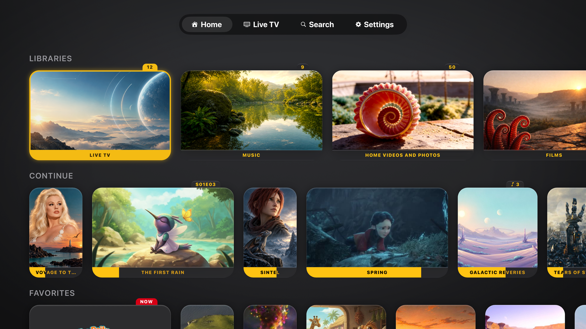

# Tomo TV, a Jellyfin Client

[](LICENSE)
[](https://github.com/keiver/tomotv/actions/workflows/test-pr.yml)
[](https://www.npmjs.com/package/@keiver/tomo-engine)
[](https://www.npmjs.com/package/@keiver/tomo-live)

A free, open source Jellyfin client for Apple TV, iPhone, iPad and Mac. Files play at
original quality in Apple's own player, with an on-device FFmpeg engine doing the
format work the server would otherwise transcode: MKV and AVI, Dolby Vision,
Dolby Atmos, PGS subtitles and Live TV. Built with React Native (react-native-tvos)
and Expo.

<p align="center">
  <a href="https://apps.apple.com/us/app/tomo-tv/id6755077888">
    
  </a>
</p>

<p align="center">
  <a href="https://apps.apple.com/us/app/tomo-tv/id6755077888">
    
  </a>
</p>

## How playback works

Video plays in the system's `AVPlayer`, so the transport, AirPlay and Picture in
Picture are Apple's own. A streamed video goes through an engine on the device:
it reads the original file from the server, does the format work with its own
FFmpeg build, and hands AVPlayer an HLS stream it serves on loopback. It reads
the original over three ranged connections at once when the server answers
range requests. An audio file or a download that AVPlayer opens on its own, and
that needs nothing from the engine, plays as it is.

```
Jellyfin server          serves the original file
        |
        v
Engine on the device     @keiver/tomo-engine with its own FFmpeg
        |
        v
HLS on loopback          a playlist and segments the engine writes
        |
        v
AVPlayer / AVKit         Apple's player
```

A streamed video starts in one of three lanes:

| Lane                    | What happens                                       |
| ----------------------- | -------------------------------------------------- |
| **On-device copy**      | Container rewrapped, streams copied byte for byte  |
| **On-device transcode** | Software decode + VideoToolbox encode, still local |
| **Server**              | Jellyfin transcodes; the fallback, not the default |

The lane is measured on the device, not assumed. H.264 and HEVC are copied only
when this device's VideoToolbox opens them in hardware at the file's own size,
and AV1 only where the hardware decodes it. Interlaced sources are deinterlaced
on device rather than copied, and every other codec the engine accepts is
re-encoded locally. 8K video the device cannot copy goes to the server. If
on-device conversion cannot keep up, playback falls back to the server. Two
such measurements on the same app build keep that file on the server for 30
minutes.

When the server may be asked at all is a setting, Settings > Server
transcoding: **When needed** (the default) for files the device cannot play and
smaller streams on a slow connection, **Only for unsupported files**, where a
slow connection waits on the original, or **Off**. The account's own transcoding
permission on the server overrides all three.

- **Dolby Vision.** Profile 7 is rewritten to single-layer 8.1 during the copy.
  Every other profile is copied as it is.
- **Audio.** AAC, ALAC, AC-3, E-AC-3 and well-formed FLAC are copied, so Dolby
  Atmos in E-AC-3 reaches the receiver untouched. On tvOS and iOS 26 and later,
  a preferred TrueHD Atmos or DTS:X track becomes Apple's spatial audio codec
  (APAC, 7.1.4) through
  [SpatialAudioBridge](https://github.com/kristofferR/SpatialAudioBridge). The
  other tracks, TrueHD and DTS-HD among them, PCM, MP3, Opus and the rest are
  decoded to lossless FLAC, up to 7.1, or to AAC where FLAC cannot be used.
  Switching audio tracks does not restart playback.
- **Subtitles** never send a file to the server's transcoder. Embedded text
  tracks become WebVTT on the device, sidecar text files arrive as the server's
  WebVTT and sidecar image files as they are, and image tracks (PGS, VobSub,
  DVB, XSUB) are decoded to bitmaps drawn over the native player.
- **Scrubbing** shows the file's own keyframes, read from the original. A
  picture larger than 1080p is scaled to 1080p and an HDR picture is converted
  to standard range first.
- **Quality.** Auto plays the original alone when the connection can carry it.
  On a slower connection the playlist adds smaller server streams, if the
  account is allowed to transcode and Server transcoding is at When needed, and
  AVPlayer switches between them and the original. The connection is timed on
  real files: Settings reads ten seconds of one in the library.
- **Live TV** uses the same engine. HLS and DASH origins are read directly, tuner
  streams are read from their source when the device can reach it, otherwise
  through the server untouched, and the server's live transcode is the fallback.
- **FFmpeg** is built in this repo from pinned sources, with every native decoder
  enabled, published by CI and fetched when `@keiver/tomo-engine` installs. DivX 3,
  RealVideo, Theora, DV and Cinepak all play on the device; the measured list is in
  [`docs/playback-coverage.md`](docs/playback-coverage.md).

## Core packages

The engine and the live TV services are npm packages developed here, usable by
any Expo app on Apple TV, iOS or Mac Catalyst. Neither knows Jellyfin: Tomo connects them in
`services/localRemux.ts` and `services/liveChannels.ts`.

| Package                                       | Holds                                                                                                                                                                               |
| --------------------------------------------- | ----------------------------------------------------------------------------------------------------------------------------------------------------------------------------------- |
| [`@keiver/tomo-engine`](packages/tomo-engine) | The engine, native XMLTV and M3U parsing, frame grabs, probes, the pinned FFmpeg build, and the player's startup checks, error IDs, track language rules and image subtitle overlay |
| [`@keiver/tomo-live`](packages/tomo-live)     | Warm neighbour channels, focus previews, live frames and clips, channel health, guide sources, `LiveClip`                                                                           |

Here they are npm workspaces, so Tomo builds against the source in the same
commit. A commit that changes a published package gets a patch bump from the
pre-commit hook, Test PR fails a package change without a new version, and a
merge to `main` publishes it (`.github/workflows/publish-packages.yml`).

## Getting started

Tomo TV runs on tvOS, iOS and iPadOS 16.4 or later, and on macOS 13.4 or later (Apple
Silicon and Intel). What it supports on each is in [FEATURES.md](FEATURES.md).

You need a Jellyfin server (10.10 or later for Skip Intro), Node.js 18 or later,
and Xcode 26 or later. CocoaPods is installed through Homebrew if missing.

```bash
git clone https://github.com/keiver/tomotv.git
cd tomotv
npm install            # links the packages, fetches the FFmpeg frameworks, applies patches, regenerates licenses
npm run clear         # prepares iOS, Mac, then tvOS; opens Xcode and starts Metro
```

In the root `TomoTV.xcworkspace`, choose the scheme for your device:

| Scheme         | Destination                                |
| -------------- | ------------------------------------------ |
| `TomoTV-iOS`   | iPhone or iPad                             |
| `TomoTV-macOS` | My Mac (Mac Catalyst), macOS 13.4 or later |
| `TomoTV-tvOS`  | Apple TV                                   |

Build and run from Xcode. The Mac app supports Apple Silicon and Intel. For Mac
alone, use `npm run clearmac`. To prepare the projects without opening Xcode or
starting Metro, use `npm run prebuild:all` or `npm run prebuild:mac`.
The scripts detect a missing Metal Toolchain and offer to install it after
approval. Signing and local FFmpeg setup are covered in
[the release guide](docs/RELEASING.md#mac-setup-and-local-validation).

In the app, open **Settings → Scan Network** to find servers on your network, or
type an address; reverse-proxy paths work. Sign in with Quick Connect or a
password. Submitting the empty Add Server field connects to Jellyfin's public
demo.

## Development

```bash
npm start               # Metro dev server
npm run logs            # native logs from the booted simulator
npm run lint            # eslint + prettier
npm test                # jest unit and integration tests, the packages' JS included
npm run test:engine     # the engine's Swift tests, on the Mac
npm run test:playback   # the playback suite, against a real server
npm run test:release    # project generation, signing hooks and store workflow checks
```

Native code lives in `packages/*/ios` and `native/`; `plugins/` and `scripts/`
configure the projects. The `ios/`, `macos/` and `tvos/` folders are generated by
prebuild, and edits there are lost.

```
app/                    expo-router screens
components/             UI
hooks/useVideoPlayback  the playback state machine
services/
  localRemux.ts         lane choice and the Jellyfin item to engine session mapping
  liveChannels.ts       Tomo's channels as @keiver/tomo-live reads them
  jellyfin/             API client, split by concern
  syncPlayManager.ts    SyncPlay groups and command scheduling
  downloads/            offline store
  books/                book formats and reading position
  lyrics/               lrclib.net lookup, timing lyrics to what the device heard, saving them to the server
  i18n/                 strings: en, de, fr, es
packages/
  tomo-engine/          @keiver/tomo-engine
    ios/LocalRemuxer/   the engine: remux, transcode, loopback server, subtitles, Dolby Vision, live
    ios/LiveSources/    XMLTV guides and M3U playlists, loaded and parsed natively
    src/                the typed JS API over both native modules, and player logic that needs no server
    Package.swift       SwiftPM package for the engine tests
  tomo-live/            @keiver/tomo-live
    src/                ring, previews, frames, channel health, guide sources
    ios/                the LiveClip Expo module
native/ios/
  TunerGroups/          a Jellyfin tuner's groups and channel ids, over the engine's playlist loader
  MultiAudioResourceLoader/   HLS manifests, audio track switching
  AudioQueuePlayer/     music queue, lyrics, Now Playing, tvOS Up Next panel
  LyricsListener/       the system speech transcriber, listening to a song for its words and their times
  BookRenderer/         PDF, comic, EPUB and MOBI pages
  TopShelf/             tvOS Top Shelf extension
  Package.swift         SwiftPM package for the book tests
modules/tomo-toast/     the in-app toast strip, an Expo module
constants/codecs.ts     the direct-play codec list
test/playback/          the playback regression suite
```

`test:engine` runs the Swift tests on the Mac: the engine's (Dolby Vision
conversion against committed fixtures, the playlist rules, a codec matrix that
records which codecs are proven by a fixture) and the book renderer's in
`native/ios`.

`test:playback` deep-links the app into the player against a real Jellyfin server,
across 101 items (96 files and 5 Live TV channels). It catches what unit tests
cannot: an item taking the wrong lane, playback that does not advance, and engine
output that drifts from the committed baselines. If you touch the engine or its
allowlists, run it and say so in the PR. See
[`test/playback/README.md`](test/playback/README.md).

`react-native-video` carries a local patch, applied on `npm install`, for the tvOS
AVKit features (Up Next, the info panel, chapters, channel flipping) and upstream
fixes. An upgrade that breaks the patch fails the install instead of silently
dropping them. To change it, edit `node_modules/react-native-video/` and run
`npx patch-package react-native-video`.

Releasing the app is a maintainer step: [`docs/RELEASING.md`](docs/RELEASING.md).
`npm run archive -- <next-build>` archives iOS, Mac and tvOS in that order with
one increasing build number. Mac screenshots are captured manually into
`applestore/captures/mac/`; `npm run shots -- --render` composes the store images.

## Contributing

Fork, branch from `main`, follow the existing patterns, add tests, and run
`npm test` and `npm run lint` before opening a PR. Strict TypeScript, cleanup on
every effect, and no scale animations on grid items. Keep Jellyfin and Tomo out
of `packages/`: it ships to npm. More in [CONTRIBUTING.md](CONTRIBUTING.md);
security reports go through [SECURITY.md](SECURITY.md).

## Disclaimer

Tomo TV is a player. It hosts, distributes and ships no media, channels,
playlists or guides: it plays what your Jellyfin server and the sources you add
provide, and you are responsible for having the right to access them. It is
provided as is, without warranty, under the MIT License.

Tomo TV is an independent client, not affiliated with or endorsed by the
Jellyfin project. Jellyfin is a trademark of its respective owner. Apple, Apple
TV, iPhone, iPad and AirPlay are trademarks of Apple Inc. Dolby, Dolby Vision and
Dolby Atmos are trademarks of Dolby Laboratories Licensing Corporation. All other
marks belong to their owners.

The screenshot above shows artwork from Sintel, © Blender Foundation |
durian.blender.org, under CC BY 3.0, and Spring, © Blender Foundation |
studio.blender.org, under CC BY 4.0. Rights concerns go to
<contact@keiver.dev>.

## A Note on AI

I use Claude and other AI tools for drafting code and documentation.
Architecture and decisions are mine. Blame me for any shady code.

## License

MIT. See [LICENSE](LICENSE). Both packages are MIT as well.

The shipped media stack is third-party and separately licensed: FFmpeg
(LGPL 3.0), libzvbi (LGPL 2.0 or later), Mbed TLS, dav1d, uavs3d, libass,
FreeType, HarfBuzz, GNU FriBidi, libarchive, XZ Utils and foliate-js.
Full texts and per-component copyright are in the app under
**Settings → Open Source**, and the engine's in
[`packages/tomo-engine/NOTICE.md`](packages/tomo-engine/NOTICE.md).

## Acknowledgments

- **Jellyfin Team** for the open source media server
- **Expo** and **react-native-tvos** for Apple TV support
- **Blender Foundation** for open movie test files (Sintel, Cosmos Laundromat)
- The **Matroska test suite** for container test files used in development

## Links

- **Site:** [tomotv.app](https://tomotv.app/)
- **Support:** <contact@keiver.dev>
- **npm:** [@keiver/tomo-engine](https://www.npmjs.com/package/@keiver/tomo-engine), [@keiver/tomo-live](https://www.npmjs.com/package/@keiver/tomo-live)
- **expo-tvos-search:** [github.com/keiver/expo-tvos-search](https://github.com/keiver/expo-tvos-search)
